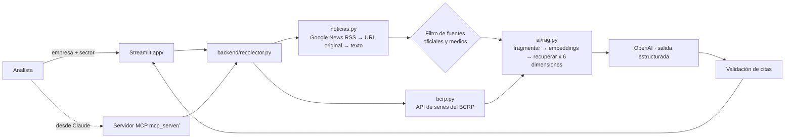

# 🔎 Auditrail

*El entorno del deudor, con evidencia auditable.* El nombre viene de **audit trail** (rastro de auditoría): cada afirmación del informe deja su rastro hasta la fuente.

> **Hacemos el análisis de contexto externo de una empresa para los auditores internos de riesgo de crédito del Perú, mediante un RAG sobre noticias de medios confiables y series oficiales del BCRP que cita la fuente de cada afirmación.**

Escribes el nombre de la empresa y, en alrededor de un minuto, obtienes por qué le estaría yendo bien o mal **más allá de sus estados financieros**: macroeconomía, sector, clima, regulación, factores sociales y noticias de la propia empresa. Cada afirmación trae su fuente enlazada.

| | |
|---|---|
| **Demo** | `[COMPLETAR: URL de Streamlit Community Cloud]` · o en local: ver [Cómo correrlo](#cómo-correrlo) |
| **Video de respaldo (60–90 s)** | `[COMPLETAR: link]` |
| **Curso** | Data Science con Python · Universidad del Pacífico · 2026-II |

---

## 1. One-liner

Hacemos el **análisis de contexto externo** (X) para **los auditores internos que revisan la clasificación del deudor** (Y) mediante un **RAG con citas obligatorias sobre fuentes verificadas** (Z).

## 2. Founder

**Henry Luis Llupton Capuñay**. `[COMPLETAR: foto en docs/img/founder.jpg]`

Estudiante de último ciclo de Economía en la Universidad del Pacífico. Trabajo en auditoría interna de riesgos en banca, donde reviso la clasificación crediticia de empresas. Conozco el problema desde adentro: el análisis se apoya en el historial crediticio y en los estados financieros, pero el contexto externo casi nunca se revisa de forma sistemática.

**Cómo cubro cada frente con agentes de IA:**
- **Producto:** el problema y los criterios (qué dimensiones importan y qué fuentes son confiables) los defino yo, a partir de mi trabajo y de las entrevistas.
- **Ingeniería:** Claude Code es mi co-founder técnico (ver la sección 9).
- **Diseño:** la interfaz en Streamlit y el informe en PDF (LaTeX) están pensados para adjuntarse al papel de trabajo de auditoría.
- **Ventas:** mi red en banca y en microfinanzas, más el servidor MCP, que deja usar el producto desde Claude sin instalar nada.

## 3. Problema

**Quién lo sufre.** Los **auditores internos de riesgo de crédito** de bancos del Perú. Como parte de la evaluación que exige la SBS, reciben una muestra de deudores (desde medianas empresas hasta corporativos) y deben verificar si la clasificación que les asignó el área de negocios es consistente con su situación.

**Qué pasa hoy.** Revisan el historial crediticio y los estados financieros, pero el **contexto externo** (un Fenómeno El Niño que golpea al sector, un paro de transportistas, un cambio tributario, una adquisición apalancada) se busca a mano en Google o directamente no se revisa. Los estados financieros miran el pasado; el riesgo se mueve con el contexto.

**Cuánto les cuesta.** `[COMPLETAR con los datos de las 3 entrevistas: horas por empresa dedicadas al contexto, empresas por mes y un caso concreto de deterioro por un factor externo no anticipado]`

**Cómo lo resuelven hoy sin Auditrail.** Búsquedas manuales en Google y en medios, revisión ocasional de reportes del BCRP, conocimiento tácito del auditor, o simplemente no hacerlo.

**Evidencia.** Las notas de 3 conversaciones con usuarios potenciales están en [`docs/research/`](docs/research/), junto con la guía de entrevista.

## 4. Solución e insight

**Qué construí.** Un pipeline que, a partir del nombre de la empresa y su sector:
1. **Busca noticias** de los últimos N días en Google News, descarta redes sociales y blogs, y **descarga el texto completo** solo de medios reconocidos y fuentes oficiales.
2. **Descarga series oficiales del BCRP**: PBI, inflación, tasa de referencia, tipo de cambio, PBI del sector y expectativas empresariales del sector. Los estadísticos los calcula Python, no el modelo.
3. **RAG por dimensión:** fragmenta, embebe y hace una búsqueda por cada una de las 6 dimensiones de riesgo, para que las noticias de la empresa no tapen el clima o la regulación.
4. **Genera un informe con salida estructurada:** señal por dimensión, factores explicativos, **insumos para la clasificación del deudor según la Res. SBS N.° 11356-2008**, puntos de verificación para la auditoría y vacíos de información.
5. **Valida las citas:** toda afirmación que cite una fuente inexistente, o que no cite ninguna, **se elimina** antes de mostrarse.

**Insight.** El valor no está en "resumir noticias", sino en **convertir el contexto en algo auditable**. Un auditor no puede sustentar un hallazgo con "la IA dice que". Acepta "el PBI del sector cayó X % en tal mes [S3, BCRP]". Por eso la regla de diseño central es **sin fuente, no hay afirmación**. Además, los *puntos de verificación* convierten el contexto en una acción concreta: qué revisar en el expediente de crédito y en la sustentación de la clasificación.

**Anclado en la regulación.** El Reglamento para la Evaluación y Clasificación del Deudor y la Exigencia de Provisiones (Res. SBS N.° 11356-2008), modificado por la **Res. SBS N.° 2368-2023** ([texto oficial](https://intranet2.sbs.gob.pe/dv_int_cn/2290/v2.0/Adjuntos/2368-2023.pdf)), define la categoría *Con Problemas Potenciales* de un deudor no minorista así: *"El flujo de caja podría, en los próximos doce (12) meses, debilitarse para afrontar los pagos, dado que es sumamente sensible a modificaciones de variables relevantes como entorno económico, comercial, regulatorio, político, entre otros"* (numeral 2.2 a), vigente desde el 01/10/2024). Esa sensibilidad al entorno es justo la parte del análisis que hoy se revisa a mano o no se revisa, y es la que el auditor debe poder contrastar. Auditrail la documenta con fuentes, agrupada por esas mismas variables ([`backend/models.py`](backend/models.py), `CRITERIOS_SBS` y `NORMA_CPP`), y con el mismo horizonte de 12 meses. Además:
- La 2368-2023 tipifica los créditos por **ventas anuales declaradas a SUNAT** (corporativo > S/ 200 MM, gran empresa > S/ 20 MM, mediana > S/ 5 MM). Cuando la evidencia trae las ventas, la ficha muestra el **tipo de crédito referencial**; la tipificación oficial la hace la entidad.
- Para **pequeña y microempresa**, la misma norma permite considerar *"información sobre el entorno social y económico del deudor"*: el contexto también sirve fuera de la cartera no minorista.
- Auditrail **no asigna la categoría** (Normal, CPP, Deficiente, Dudoso o Pérdida): esa decisión es de la entidad y la revisa el auditor.

## 5. Why now

- Los LLM con **salidas estructuradas** permiten obligar a que cada hallazgo traiga sus fuentes y validarlo con código. Hace tres años eso no era confiable.
- Los **embeddings** cuestan una fracción de centavo por informe. Ver el costo por informe en la sección 7.
- El **BCRP expone una API abierta** con más de 17 mil series, y el protocolo **MCP** deja que el analista consulte todo desde Claude sin otra interfaz.

## 6. Demo

**URL:** `[COMPLETAR]` · **Capturas del flujo principal:** `[COMPLETAR: docs/img/01_busqueda.png, 02_informe.png, 03_fuentes.png]`

### Arquitectura



### Modelos y APIs, y por qué

| Componente | Qué usamos | Por qué |
|---|---|---|
| Generación | OpenAI `gpt-4.1-mini` (configurable en `OPENAI_MODEL`) | Soporta salidas estructuradas con esquema estricto (Pydantic); costo bajo por informe. |
| Embeddings | OpenAI `text-embedding-3-small` | Barato y suficiente para recuperar unos 170 fragmentos por empresa. |
| Respaldo sin key | TF-IDF (scikit-learn) | La demo muestra la evidencia aunque no haya API key o internet. |
| Datos macro | API del BCRP | Fuente oficial, abierta y sin clave. |
| Noticias | Google News RSS + `trafilatura` | Cobertura amplia; solo se conservan medios reconocidos y fuentes `.gob.pe`. |

### Cómo correrlo

```bash
git clone https://github.com/henryluis0603/contexta && cd contexta
python -m venv .venv && source .venv/bin/activate   # Windows: .venv\Scripts\activate
pip install -r requirements.txt
cp .env.example .env        # y pega tu OPENAI_API_KEY
streamlit run app/streamlit_app.py
```

**Servidor MCP (para usarlo desde Claude Code o Claude Desktop):**
```bash
claude mcp add --scope project auditrail -- python mcp_server/server.py
```
Herramientas: `contexto_empresa`, `indicadores_sector`, `noticias_empresa`, `sectores_disponibles`, y el prompt `revision_clasificacion`.

**Pruebas:** `pytest -q` (sin internet ni API key).

## 7. Modelo de negocio

**Quién paga:** la institución financiera (gerencia de riesgos o de créditos), por analista.

| Plan | Para quién | Precio (propuesta) |
|---|---|---|
| Gratis | Analista individual que quiere probarlo | 10 informes/mes |
| Analista | Cajas, cooperativas y fintech pequeñas | `[DEFINIR, p. ej. S/ 99]` por usuario al mes, hasta 150 informes |
| Institución | Bancos | `[DEFINIR]` al mes: usuarios ilimitados, MCP y normativa interna de la entidad en el RAG (on-premise) |

**Costo por informe (medido en 3 empresas de la demo):**

| Concepto | Tokens por informe | Precio por 1M tokens | Costo |
|---|---|---|---|
| Embeddings | ~30–35 mil | `[verificar en openai.com/api/pricing]` | `[calcular]` |
| Entrada del LLM | ~6–7 mil | `[verificar]` | `[calcular]` |
| Salida del LLM | `[medir en la app; se muestra al pie del informe]` | `[verificar]` | `[calcular]` |
| Servidor | Streamlit Community Cloud | 0 | 0 |

La app muestra los tokens reales de cada informe y, si configuras los precios en `.env`, también el costo. **Margen de contribución** = precio del plan − (informes al mes × costo por informe).

## 8. Herramientas del curso

| Herramienta (sesión) | Dónde está | Para qué la usa el cliente |
|---|---|---|
| Scraping y APIs (03) | [`backend/sources/noticias.py`](backend/sources/noticias.py), [`backend/sources/bcrp.py`](backend/sources/bcrp.py) | Reunir noticias con texto completo y series oficiales del BCRP. |
| LLMs con salidas estructuradas y RAG (08) | [`ai/rag.py`](ai/rag.py), [`ai/prompts.py`](ai/prompts.py) | Generar el informe con citas y descartar lo que no tiene fuente. |
| MCP (04) | [`mcp_server/server.py`](mcp_server/server.py) | Consultar el contexto de una empresa desde Claude, en lenguaje natural. |
| Dashboards (05) | [`app/streamlit_app.py`](app/streamlit_app.py) | Semáforo por dimensión e indicadores del BCRP en gráficos. |

## 9. Qué hizo el agente

Claude Code (Anthropic) fue el co-founder técnico:
- **Generó:** la estructura del repo; la ingesta de noticias (decodificación de Google News, extracción de texto y filtro de fuentes); el cliente del BCRP (reutilizando el patrón del servidor MCP de la sesión 04); el pipeline RAG con validación de citas; la app de Streamlit; el servidor MCP; las pruebas en `tests/`, y el borrador de este README.
- **Lo que definí yo:** el problema y el usuario, las 6 dimensiones de riesgo, qué cuenta como fuente confiable, la regla "sin fuente no hay afirmación", el mapeo de sectores a series del BCRP y la validación con usuarios.
- **Cómo lo verifiqué:** pruebas unitarias, corridas reales con empresas de la lista demo y revisión de las fuentes citadas contra los artículos originales. `[COMPLETAR con lo que revisaste o cambiaste tú]`

## Limitaciones y siguientes pasos

- El demo usa solo **información pública**. La versión institucional cargaría en el RAG la normativa interna de cada entidad y los reglamentos públicos de la SBS, y correría en la infraestructura del cliente.
- Algunos medios tienen muro de pago y se descartan automáticamente.
- Siguiente: alertas semanales cuando cambia la señal de una empresa de la cartera, y comunicados ENFEN/SENAMHI como fuente directa.

## Licencia

MIT. Ver [LICENSE](LICENSE).
