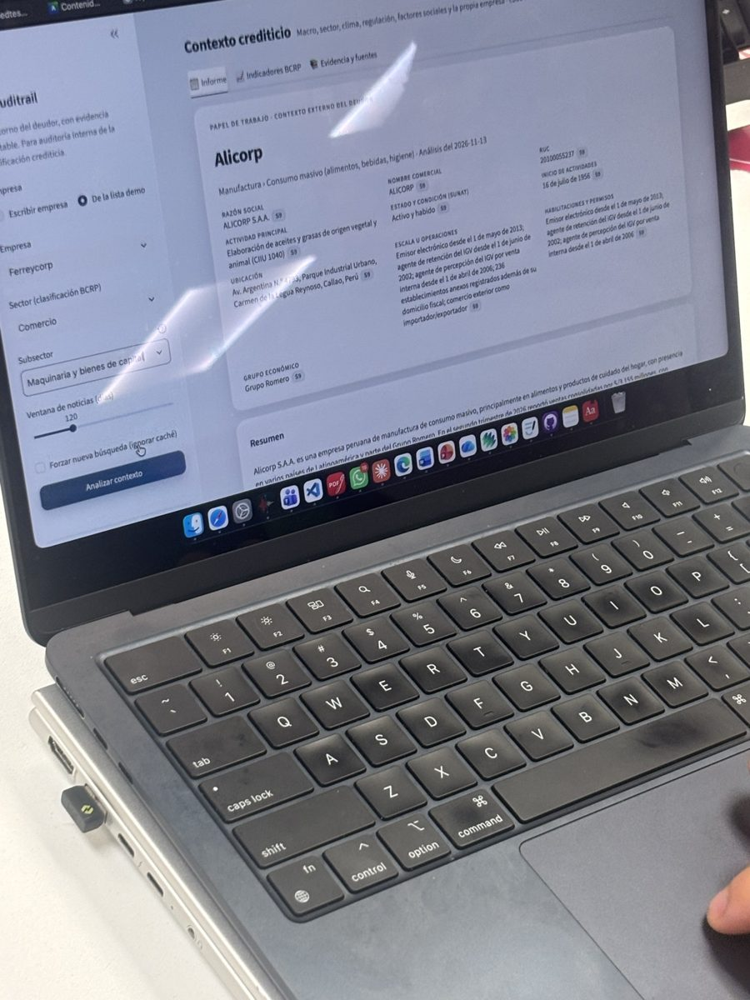
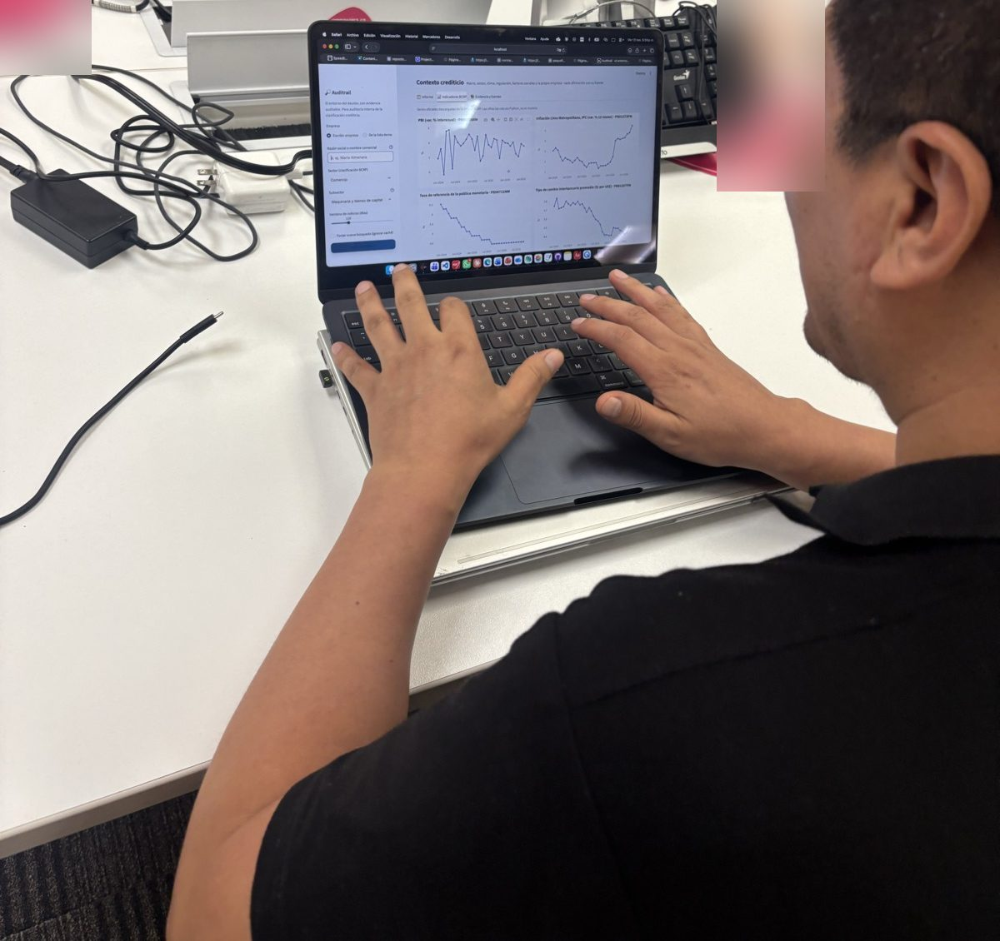
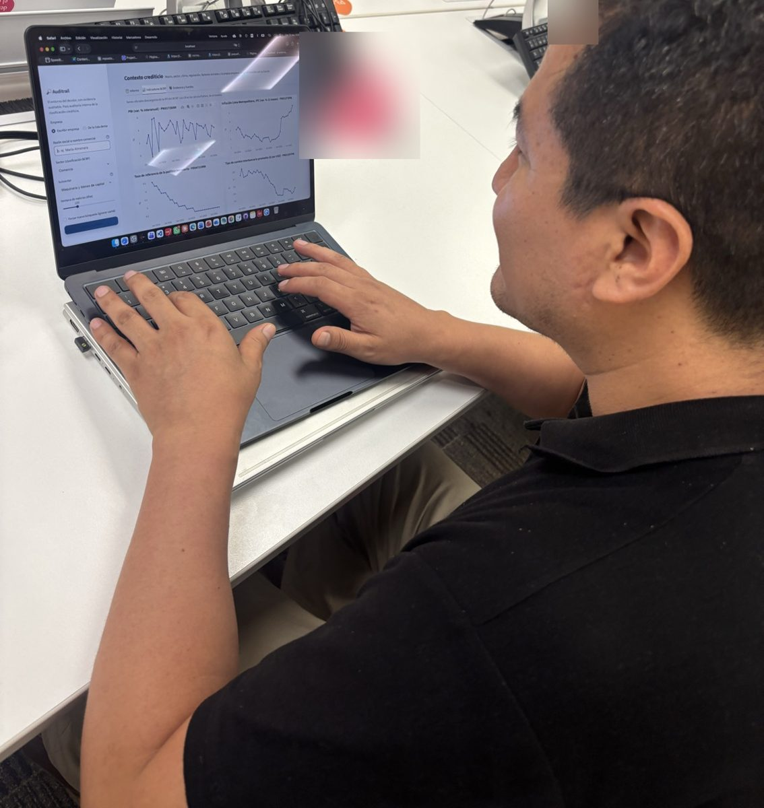
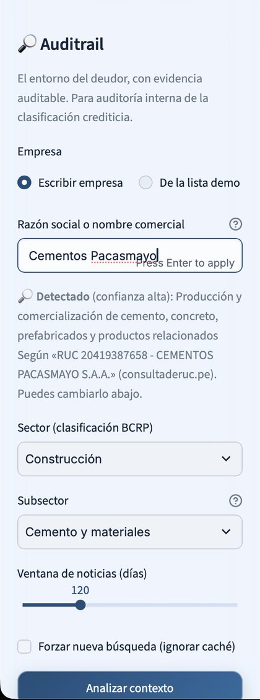
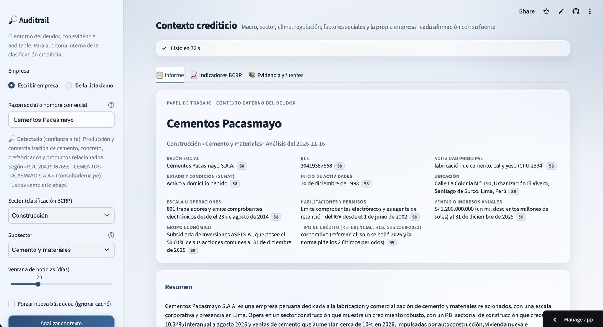
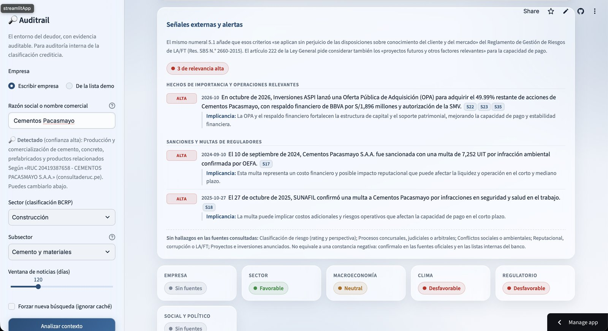
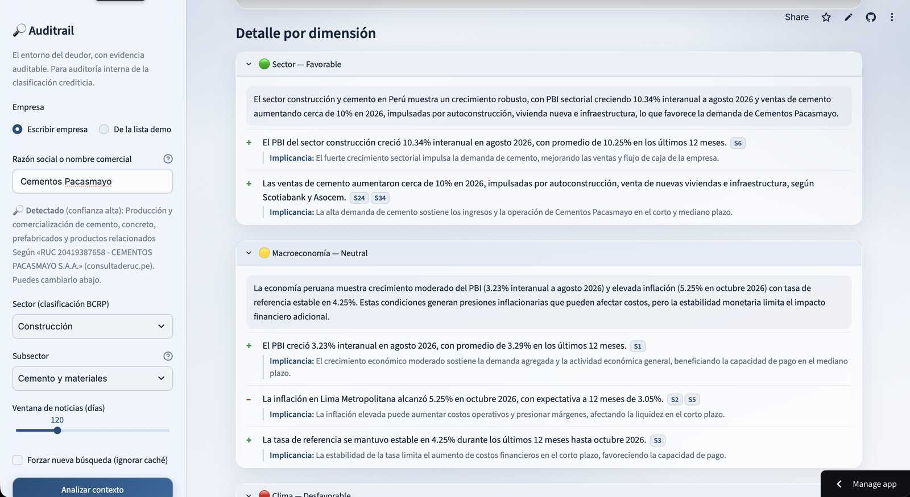
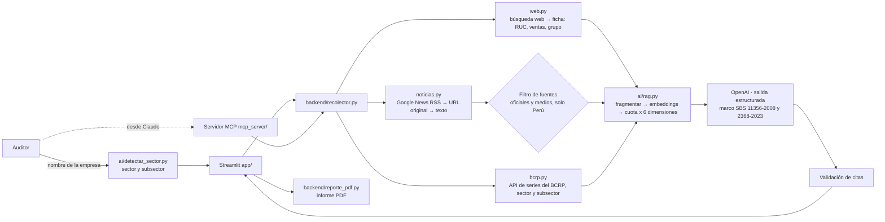

# 🔎 Auditrail

*El entorno del deudor, con evidencia auditable.* El nombre viene de **audit trail** (rastro de auditoría): cada afirmación del informe deja su rastro hasta la fuente.

> **Hacemos el análisis de contexto externo de una empresa para los auditores internos de riesgo de crédito del Perú, mediante un RAG sobre noticias de medios confiables, búsqueda web de registros públicos y series oficiales del BCRP, que cita la fuente de cada afirmación.**

Escribes el nombre de la empresa (Auditrail detecta solo su sector y subsector) y, en alrededor de un minuto, obtienes por qué le estaría yendo bien o mal **más allá de sus estados financieros**: macroeconomía, sector, clima, regulación, factores sociales y noticias de la propia empresa. Cada afirmación trae su fuente enlazada, y el informe se descarga en PDF listo para el papel de trabajo.

| | |
|---|---|
| **Demo** | **[auditrail.streamlit.app](https://auditrail.streamlit.app)** · o en local: ver [Cómo correrlo](#cómo-correrlo) |
| **Video demo (1:14)** | **[Ver en YouTube](https://youtu.be/UFqE79TUiv8)** |
| **Curso** | Data Science con Python · Universidad del Pacífico · 2026-II |

---

## 1. One-liner

Hacemos el **análisis de contexto externo** para **los auditores internos que revisan la clasificación del deudor** mediante un **RAG con citas obligatorias sobre fuentes verificadas**.

## 2. Founder


**Henry Luis Llupton Capuñay**

Estudiante de último ciclo de Economía en la Universidad del Pacífico. Trabajo en auditoría interna de riesgos en banca, donde reviso la clasificación crediticia de empresas. Conozco el problema desde adentro: el análisis se apoya en el historial crediticio y en los estados financieros, pero el contexto externo casi nunca se revisa de forma sistemática.
<br clear="right">

**Cómo cubro cada frente con agentes de IA:**
- **Producto:** el problema y los criterios (qué dimensiones importan y qué fuentes son confiables) los defino yo, a partir de mi trabajo y de las entrevistas.
- **Ingeniería:** Claude Code es mi co-founder técnico (ver la sección 9).
- **Diseño:** la interfaz en Streamlit y el informe en PDF (LaTeX) están pensados para adjuntarse al papel de trabajo de auditoría.
- **Ventas:** mi red en banca y en microfinanzas, más el servidor MCP, que deja usar el producto desde Claude sin instalar nada.

## 3. Problema

**Quién lo sufre.** Los **auditores internos de riesgo de crédito** de bancos del Perú. Como parte de la evaluación que exige la SBS, reciben una muestra de deudores (desde medianas empresas hasta corporativos) y deben verificar si la clasificación que les asignó el área de negocios es consistente con su situación.

**Qué pasa hoy.** Revisan el historial crediticio y los estados financieros, pero el **contexto externo** (un Fenómeno El Niño que golpea al sector, un paro de transportistas, un cambio tributario, una adquisición apalancada) se busca a mano en Google o directamente no se revisa. Los estados financieros miran el pasado; el riesgo se mueve con el contexto.

**Cuánto les cuesta.** El equipo entrevistado revisa **20 empresas por ciclo mensual**, repartidas entre sus integrantes, y tiene **3 días al mes** para el análisis completo de clasificación. El contexto externo es solo uno de los insumos (junto con estados financieros, historial crediticio y comportamiento bancario, que se trabajan con información interna), así que compite por ese tiempo con todos los demás insumos. Hoy, la búsqueda del contexto toma **15 a 20 minutos por empresa** y se hace **al inicio**, antes de pasar a los estados financieros y al comportamiento bancario: son **5 a 7 horas al mes** del equipo (20 empresas), dentro de una ventana de 3 días. Con Auditrail el informe sale en alrededor de un minuto y el auditor dedica unos 5 minutos a verificar las fuentes (estimación propia), así que el equipo recupera **3 a 5 horas al mes** para el análisis financiero. Además, el resultado es más completo y queda documentado: cada afirmación con su fuente, en un PDF que se adjunta al papel de trabajo, e incluye señales que una búsqueda rápida suele omitir (rating, sanciones, grupo económico).

**Lo confirmó la jefatura.** En una reunión del área se cuestionó que no se estaba considerando el contexto socioeconómico del deudor y que buscar fuentes para entender una empresa toma tiempo. Las tres personas entrevistadas (en persona, el 13/11) probaron la app y coincidieron en que es útil para tener contexto **antes** de empezar el análisis; la jefa quiere llevarla al equipo interno que desarrolla agentes para adaptarla a los lineamientos del banco.

**Cómo lo resuelven hoy sin Auditrail.** Búsquedas manuales en Google y en medios, revisión ocasional de reportes del BCRP, conocimiento tácito del auditor, o simplemente no hacerlo.

**Pruebas con usuarios.** Auditores del equipo usaron Auditrail con empresas reales (fotos con su consentimiento):

| | |
|---|---|
|  |  |
|  |  |

**Evidencia: 3 conversaciones con auditoría interna** (notas en [`docs/research/`](docs/research/), junto con la guía):

| # | Rol | Lo que planteó | Qué cambió en Auditrail |
|---|---|---|---|
| 1 | Jefa de auditoría interna | Considerar la Res. SBS N.° 2368-2023 | El informe sigue la nueva definición de CPP (sensibilidad del flujo de caja al entorno a 12 meses), calcula el tipo de crédito referencial e incluye el riesgo único y grupo económico |
| 2 | Auditor de riesgo de crédito | Saber qué dicen otros sobre la empresa, incluido el análisis de las clasificadoras (hoy lo busca rápido en Google) | Nueva sección de señales externas y alertas: rating y fundamentos de cada clasificadora, SMV, reguladores, procesos, conflictos y reputación |
| 3 | Auditor de riesgo de crédito | A futuro, incluir los estados financieros con gráficas y métricas, para cubrir la tarea central (la que más tiempo toma) y no solo ser un insumo | Fuera de esta versión: los EEFF se analizan con información interna del banco. Queda como siguiente implementación (EEFF públicos de la SMV con métricas y gráficas) |

## 4. Solución e insight

**Qué construí.** Un pipeline que, a partir del nombre de la empresa:
1. **Detecta el sector y subsector** (8 sectores, 30 subsectores) con titulares de prensa y una búsqueda web del RUC, priorizando la actividad principal.
2. **Arma la ficha de la empresa** con búsqueda web (OpenAI `web_search`, o Tavily si se configura): RUC, actividad, ventas o ingresos anuales, grupo económico y **tipo de crédito referencial** según los umbrales de la Res. SBS N.° 2368-2023. Sirve también para empresas pequeñas que casi no salen en prensa. Distingue fuentes oficiales (SMV, SUNAT, `.gob.pe`, web de la empresa) de directorios que replican registros, y no registra personas naturales.
3. **Busca noticias** de los últimos N días en Google News (consultas con sinónimos por dimensión y por subsector), descarta redes sociales, blogs y noticias de otros países, y **descarga el texto completo** solo de medios reconocidos y fuentes oficiales.
4. **Descarga series oficiales del BCRP**: PBI, inflación, tasa de referencia, tipo de cambio, PBI del sector y del subsector, y expectativas empresariales. Los estadísticos los calcula Python, no el modelo.
5. **RAG por dimensión con cuota:** fragmenta, embebe y recupera evidencia para cada una de las 6 dimensiones (macro, sector, clima, regulación, social y empresa), para que las noticias de la empresa no tapen el clima o la regulación.
6. **Genera el informe con salida estructurada:** ficha, resumen ejecutivo, señal y síntesis por dimensión (cada hallazgo con su implicancia), factores explicativos, **insumos para la clasificación del deudor agrupados por los criterios de la norma SBS**, puntos de verificación para la auditoría y vacíos de información. No hay una "señal global": cada dimensión pesa distinto y esa ponderación es del auditor.
7. **Valida las citas:** toda afirmación que cite una fuente inexistente, o que no cite ninguna, **se elimina** antes de mostrarse.
8. **Riesgo único y grupo económico:** identifica la matriz, las subsidiarias y las vinculadas, y si el grupo es un soporte o un riesgo de contagio para el deudor. La 2368-2023 (numeral 5.1) pide aplicar los criterios de evaluación *"en el contexto de su pertenencia a un grupo económico"*.
9. **Señales externas y alertas:** rating y perspectiva de las clasificadoras, hechos de importancia en la SMV, sanciones de OEFA, SUNAFIL o INDECOPI, procesos concursales y judiciales, conflictos sociales, temas reputacionales o de LA/FT y proyectos anunciados, cada uno con su fecha y relevancia. También lista las categorías **sin hallazgos**, para que el auditor sepa qué se buscó.
10. **Exporta a PDF** (LaTeX cuando hay motor instalado; si no, reportlab), con las fuentes enlazadas.

**Insight.** El valor no está en "resumir noticias", sino en **convertir el contexto en algo auditable**. Un auditor no puede sustentar un hallazgo con "la IA dice que". Acepta "el PBI del sector cayó X % en tal mes [S3, BCRP]". Por eso la regla de diseño central es **sin fuente, no hay afirmación**. Además, los *puntos de verificación* convierten el contexto en una acción concreta: qué revisar en el expediente de crédito y en la sustentación de la clasificación.

**Anclado en la regulación.** El Reglamento para la Evaluación y Clasificación del Deudor y la Exigencia de Provisiones (Res. SBS N.° 11356-2008), modificado por la **Res. SBS N.° 2368-2023** ([texto oficial](https://intranet2.sbs.gob.pe/dv_int_cn/2290/v2.0/Adjuntos/2368-2023.pdf)), define la categoría *Con Problemas Potenciales* de un deudor no minorista así: *"El flujo de caja podría, en los próximos doce (12) meses, debilitarse para afrontar los pagos, dado que es sumamente sensible a modificaciones de variables relevantes como entorno económico, comercial, regulatorio, político, entre otros"* (numeral 2.2 a), vigente desde el 01/10/2024). Esa sensibilidad al entorno es justo la parte del análisis que hoy se revisa a mano o no se revisa, y es la que el auditor debe poder contrastar. Auditrail la documenta con fuentes, agrupada por esas mismas variables ([`backend/models.py`](backend/models.py), `CRITERIOS_SBS` y `NORMA_CPP`), y con el mismo horizonte de 12 meses. Además:
- La 2368-2023 tipifica los créditos por **ventas anuales declaradas a SUNAT** (corporativo > S/ 200 MM, gran empresa > S/ 20 MM, mediana > S/ 5 MM). Cuando la evidencia trae las ventas, la ficha muestra el **tipo de crédito referencial**; la tipificación oficial la hace la entidad.
- Para **pequeña y microempresa**, la misma norma permite considerar *"información sobre el entorno social y económico del deudor"*: el contexto también sirve fuera de la cartera no minorista.
- El mismo numeral 5.1 pide aplicar los criterios en el contexto del **grupo económico y del riesgo único**, y *"sin perjuicio de las disposiciones sobre conocimiento del cliente y del mercado"* (LA/FT, Res. SBS N.° 2660-2015). Por eso Auditrail incluye una sección de grupo económico y otra de señales externas y alertas.
- Auditrail **no asigna la categoría** (Normal, CPP, Deficiente, Dudoso o Pérdida): esa decisión es de la entidad y la revisa el auditor.

## 5. Why now

- Los LLM con **salidas estructuradas** permiten obligar a que cada hallazgo traiga sus fuentes y validarlo con código. Hace tres años eso no era confiable.
- Los **embeddings** cuestan una fracción de centavo por informe. Ver el costo por informe en la sección 7.
- El **BCRP expone una API abierta** con más de 17 mil series, y el protocolo **MCP** deja que el analista consulte todo desde Claude sin otra interfaz.

## 6. Demo

**URL:** [auditrail.streamlit.app](https://auditrail.streamlit.app)

**Flujo principal** (Cementos Pacasmayo, en la app publicada):

| 1. Escribe la empresa y detecta el sector | 2. Ficha del deudor con fuentes |
|---|---|
|  |  |
| **3. Señales externas y alertas** | **4. Detalle por dimensión, cada afirmación con su fuente** |
|  |  |

### Arquitectura



### Modelos y APIs, y por qué

| Componente | Qué usamos | Por qué |
|---|---|---|
| Generación | OpenAI `gpt-4.1-mini` (configurable en `OPENAI_MODEL`) | Soporta salidas estructuradas con esquema estricto (Pydantic); costo bajo por informe. |
| Embeddings | OpenAI `text-embedding-3-small` | Barato y suficiente para recuperar unos 170 fragmentos por empresa. |
| Respaldo sin key | TF-IDF (scikit-learn) | La demo muestra la evidencia aunque no haya API key o internet. |
| Datos macro | API del BCRP | Fuente oficial, abierta y sin clave. |
| Noticias | Google News RSS + `trafilatura` | Cobertura amplia; solo se conservan medios reconocidos y fuentes `.gob.pe`. |
| Búsqueda web (ficha) | OpenAI `web_search` (Responses API); Tavily opcional | Encuentra RUC, ventas y grupo económico, incluso de empresas pequeñas; con la misma clave de OpenAI. |
| Informe PDF | LaTeX (`pdflatex`, instalado vía `packages.txt`) o `reportlab` | PDF listo para adjuntar, sin depender de que el servidor tenga LaTeX. |

### Cómo correrlo

```bash
git clone https://github.com/henryluis0603/contexta && cd contexta
python -m venv .venv && source .venv/bin/activate   # Windows: .venv\Scripts\activate
pip install -r requirements.txt
cp .env.example .env        # y pega tu OPENAI_API_KEY
streamlit run app/streamlit_app.py
```

**Servidor MCP (para usarlo desde Claude Code o Claude Desktop):**
```bash
claude mcp add --scope project auditrail -- python mcp_server/server.py
```
Herramientas: `detectar_sector_empresa`, `contexto_empresa`, `indicadores_sector`, `noticias_empresa`, `sectores_disponibles`, y el prompt `revision_clasificacion`.

**Pruebas:** `pytest -q` (sin internet ni API key).

## 7. Modelo de negocio

**Quién paga:** el área de auditoría interna (o de riesgos) de la institución financiera. En las entrevistas, la disposición a pagar fue de **S/ 20 al mes por auditor** o **S/ 70 al mes por equipo**. La decisión la toma la jefatura de auditoría con su jefatura superior, y la jefa propuso pasar la herramienta al equipo interno de desarrollo de agentes: ese es el camino al plan Institución (licencia más adaptación a la normativa interna).

| Plan | Para quién | Precio | Incluye |
|---|---|---|---|
| Auditor | Un auditor que revisa su parte de la muestra | **S/ 20 al mes** | Hasta 30 informes al mes, PDF |
| Equipo | El equipo de auditoría de crédito (hasta 5 auditores) | **S/ 70 al mes** | Hasta 100 informes al mes, PDF, cuentas para todo el equipo |
| Institución | Bancos con varios equipos | A medida | Usuarios ilimitados, MCP y normativa interna de la entidad en el RAG (on-premise) |

**Por qué el plan Equipo es el que más conviene.** Un equipo que revisa 20 empresas al mes gasta en API unos S/ 6 (20 × S/ 0.30), así que con S/ 70 el **margen de contribución es ≈ S/ 64 al mes (≈ 91 %)**. Para el equipo son S/ 3.50 por empresa analizada, o unos S/ 14 a S/ 23 por cada hora que recupera dentro de su ventana de 3 días. Por eso el plan Equipo se vende como el principal y el plan Auditor sirve de entrada para probarlo.

**Costo por informe.** Tokens medidos en 7 informes reales (Cementos Pacasmayo, Alicorp, Karin Eco Fish, Pesquera Juanita, entre otras). Precios de OpenAI verificados el 14/11/2026 en [developers.openai.com/api/docs/pricing](https://developers.openai.com/api/docs/pricing).

| Concepto | Cantidad típica por informe | Precio | Costo (US$) |
|---|---|---|---|
| Embeddings (`text-embedding-3-small`) | 40–60 mil tokens | US$ 0.02 / 1M tokens | 0.001 |
| Entrada del LLM (`gpt-4.1-mini`) | 12–17 mil tokens | US$ 0.40 / 1M tokens | 0.007 |
| Salida del LLM | 2–4.5 mil tokens | US$ 1.60 / 1M tokens | 0.007 |
| Búsqueda web (detección, ficha, grupo, mercado y cumplimiento) | 5 llamadas | US$ 10 / mil llamadas + 8 mil tokens de contenido por llamada a tarifa de entrada | 0.066 |
| Detección de sector (LLM) | ~2 mil tokens | tarifa de `gpt-4.1-mini` | 0.001 |
| Servidor | Streamlit Community Cloud | 0 | 0 |
| **Total** | | | **≈ 0.08 (≈ S/ 0.30)** |

La búsqueda web es el 80 % del costo, y se guarda en caché por un día: repetir una empresa el mismo día cuesta ≈ US$ 0.015. Con 100 informes al mes (tope del plan Equipo), el costo variable es ≈ US$ 8 (≈ S/ 30).

La app muestra los tokens reales al pie de cada informe y, si configuras los precios en `.env` (ver `.env.example`), también el costo. **Margen de contribución** = precio del plan − (informes al mes × costo por informe). Plan Equipo con 20 informes: S/ 70 − S/ 6 ≈ S/ 64. En el peor caso (100 informes): S/ 70 − S/ 30 = S/ 40.

## 8. Herramientas del curso

| Herramienta (sesión) | Dónde está | Para qué la usa el auditor |
|---|---|---|
| Scraping y APIs (03) | [`backend/sources/noticias.py`](backend/sources/noticias.py), [`backend/sources/bcrp.py`](backend/sources/bcrp.py), [`backend/sources/web.py`](backend/sources/web.py) | Reunir noticias con texto completo, series oficiales del BCRP y la ficha de la empresa desde la web. |
| LLMs con salidas estructuradas y RAG (08) | [`ai/rag.py`](ai/rag.py), [`ai/prompts.py`](ai/prompts.py), [`ai/detectar_sector.py`](ai/detectar_sector.py) | Detectar el sector, generar el informe con citas y descartar lo que no tiene fuente. |
| MCP (04) | [`mcp_server/server.py`](mcp_server/server.py) | Consultar el contexto de una empresa desde Claude, en lenguaje natural. |
| Dashboards (05) | [`app/streamlit_app.py`](app/streamlit_app.py), [`app/estilo.py`](app/estilo.py) | Ficha, señal por dimensión, insumos SBS e indicadores del BCRP en una sola vista, con descarga en PDF. |

## 9. Qué hizo el agente

Claude Code (Anthropic) fue el co-founder técnico:
- **Generó:** la estructura del repo; la ingesta de noticias (decodificación de Google News, extracción de texto, filtro de fuentes y de noticias de otros países); el cliente del BCRP con las series por subsector; la búsqueda web y la ficha de la empresa; el detector de sector; el pipeline RAG con cuota por dimensión y validación de citas; la app de Streamlit y su diseño; el PDF en LaTeX con respaldo en reportlab; el servidor MCP; las pruebas en `tests/` y la primera versión de este README, que luego revisé y completé.
- **Lo que definí yo:** el problema y el usuario (auditoría interna, no el área comercial), las 6 dimensiones de riesgo, qué cuenta como fuente confiable, la regla "sin fuente no hay afirmación", el anclaje en la Res. SBS N.° 11356-2008 y su modificación 2368-2023 (por indicación de mi jefatura), y la validación con usuarios.
- **Lo que corregí tras revisar los resultados:**
  - Quité la "señal global": contradecía a las dimensiones (Southern Copper salía favorable con mayoría de dimensiones desfavorables) y cada dimensión pesa distinto.
  - Cambié "preguntas para el cliente" por **puntos de verificación**: el usuario es el auditor, no el ejecutivo comercial.
  - Detecté dimensiones "sin evidencia" (Karin Eco Fish) y el agente las corrigió con consultas con sinónimos y cuota por dimensión.
  - Detecté noticias de Colombia mezcladas en el informe y un sector mal asignado (Luz del Sur como generación), y se corrigieron.
  - En la prueba de alertas, la búsqueda web leyó una multa de OEFA de "7,252 (siete con 252/1000) UIT" como 7 mil UIT. Lo detecté contrastando con la resolución en gob.pe y se agregó una regla sobre la coma decimal.
  - Pedí que empresas pequeñas como Sycpha S.A.C. tuvieran ficha: de ahí salió la búsqueda web.
- **Cómo lo verifiqué:** 12 pruebas unitarias (`pytest -q`), corridas reales con más de 10 empresas (de corporativos a pequeñas) y revisión de las fuentes citadas contra los documentos originales; el texto de la Res. SBS N.° 2368-2023 se verificó contra el PDF oficial. En las entrevistas, la jefatura pidió anclar el análisis en la Res. SBS N.° 2368-2023 y un auditor pidió saber qué dicen terceros sobre la empresa: ambos pedidos se implementaron (secciones de insumos SBS, grupo económico y señales externas y alertas).

## Limitaciones y siguientes pasos

- El demo usa solo **información pública**. La versión institucional cargaría en el RAG la normativa interna de cada entidad y los reglamentos públicos de la SBS, y correría en la infraestructura del cliente.
- Algunos medios tienen muro de pago y se descartan automáticamente.
- La ficha depende de lo que esté publicado en la web: si no hay ventas públicas, el tipo de crédito queda como "No determinable".
- Siguiente: estados financieros públicos (SMV) con métricas y gráficas, contrastados con el entorno, pedido en la entrevista 3. Es el paso para que Auditrail apoye la tarea central del análisis (la que más tiempo toma) y no solo el contexto inicial.
- Siguiente: alertas semanales cuando cambia la señal de una empresa de la cartera, y comunicados ENFEN/SENAMHI como fuente directa.

## Licencia

MIT. Ver [LICENSE](LICENSE).
