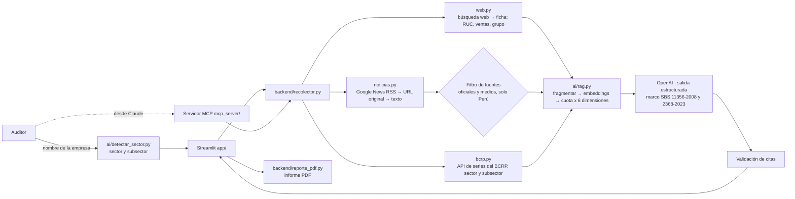

# Arquitectura de Auditrail

El auditor escribe el nombre de la empresa; Auditrail detecta su sector, reúne evidencia (búsqueda web, noticias y series del BCRP), genera el informe con un LLM con salida estructurada y elimina toda afirmación sin cita válida antes de mostrarla en la app o en el PDF.

